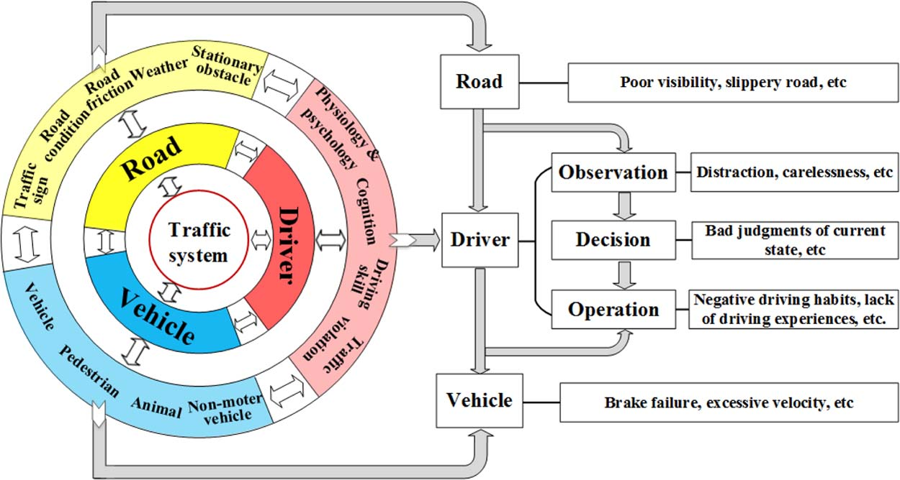
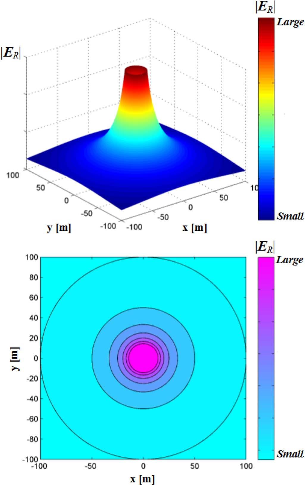
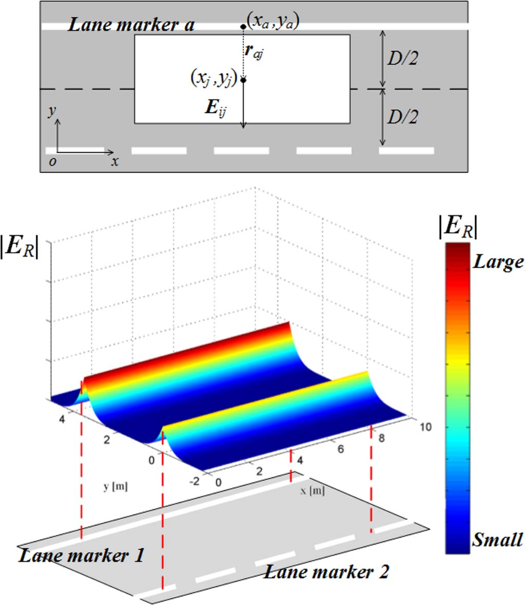
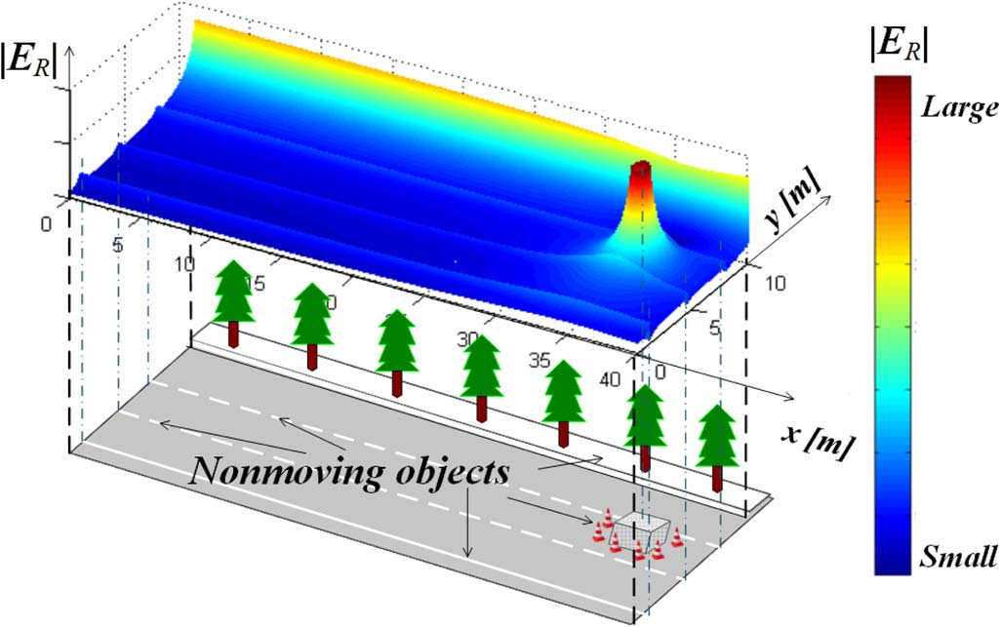
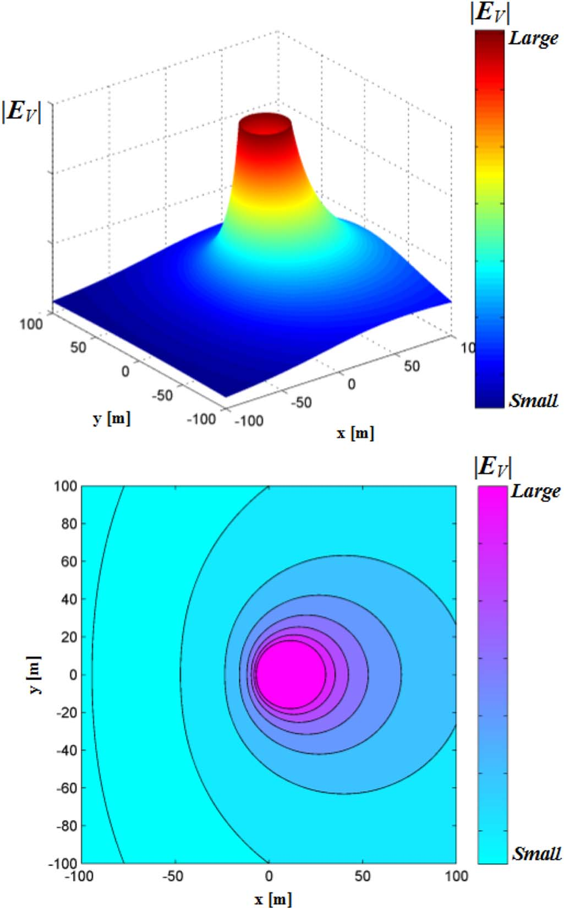
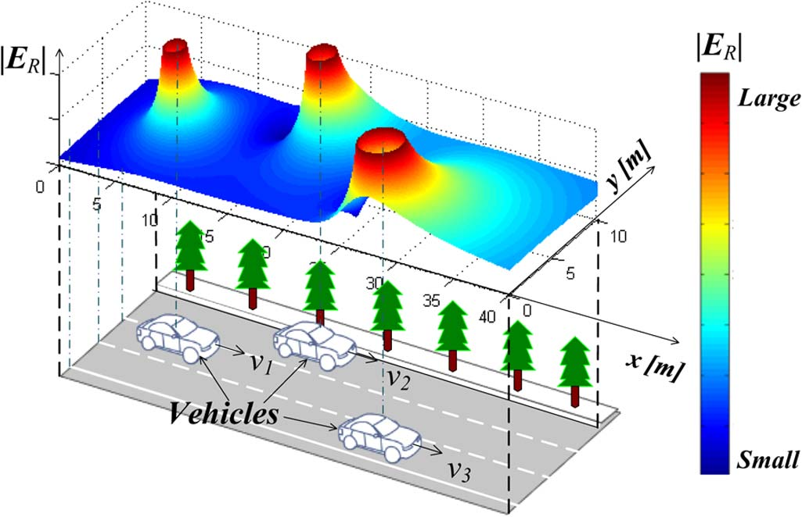
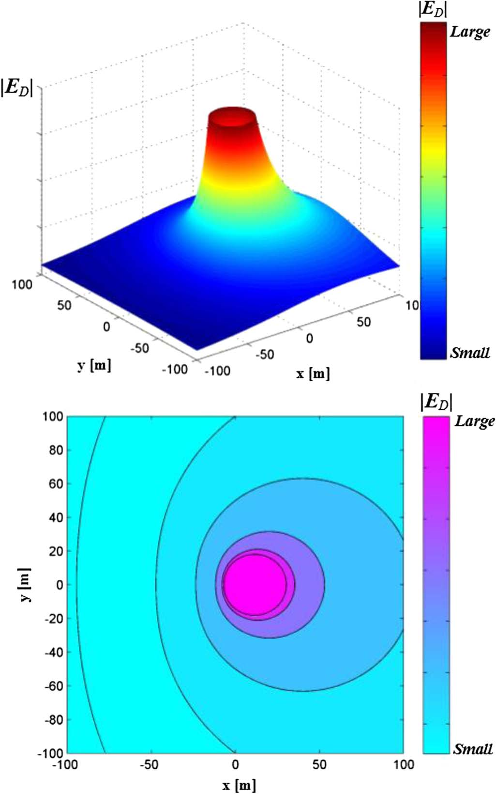
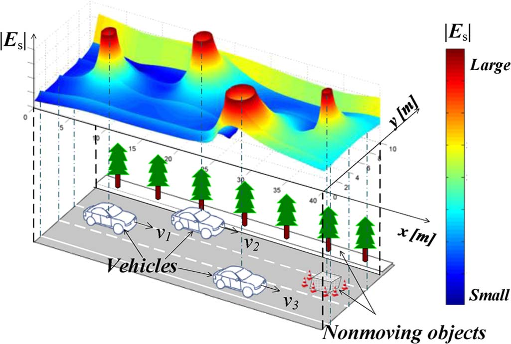
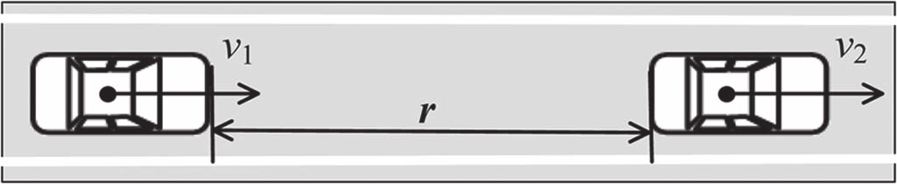
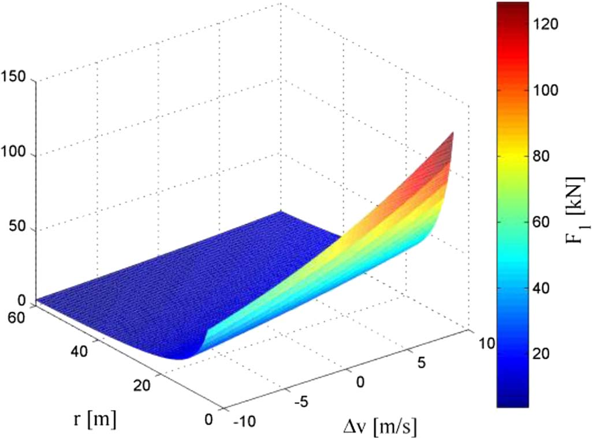

# 運転者・車両・道路の相互作用に基づく運転安全場 (The Driving Safety Field Based on Driver-Vehicle-Road Interactions)

Jianqiang Wang, Jian Wu, and Yang Li

書誌情報: IEEE Transactions on Intelligent Transportation Systems, Vol. 16, No. 4, August 2015, pp. 2203-2214

> 原文: Wang et al., IEEE T-ITS 2015. 原文ファイル: ../drive safety field.jsp の12ページ全文の忠実訳。

## Abstract (要旨)

車両の運転安全性は、運転者、車両、道路環境を含む多くの要因に影響される。これらの間の相互作用はきわめて複雑である。結果として、運転安全性を評価する既存の手法は、考慮する要因とその相互作用が限られているため、不十分な性能しか示さない。そのため、運動学ベースや動力学ベースの車両運転安全支援システムが、ますます複雑化する交通環境に適応することは困難である。本論文では、新しい概念、すなわち運転安全場 (driving safety field) を提案する。この概念は、場の理論を用いて、運転者、車両、道路条件、その他の交通要因によるリスク要因を表現する。運転安全場の統一モデルを構築し、それは次の3つの部分を含む。1) ポテンシャル場 (potential field)。道路上の静止物体、例えば停止車両によって決定される。2) キネティック場 (kinetic field)。道路上の運動物体、例えば車両や歩行者によって決定される。3) 行動場 (behavior field)。運転者の個人的特性によって決定される。さらに、このモデルの応用を提案し、典型的な追従走行シナリオへの適用によってその有用性を例示する。これは複数の交通要因によって生じるリスクを評価するものである。運転安全場は、運転者・車両・道路の相互作用とそれらが運転安全性に与える影響を明らかにし、動的変化による運転安全性の傾向を予測できる。加えて、このモデルは、複雑な交通環境下での運転安全対策と車両の能動制御を確立するための新しい基礎を提供できる。

## Index Terms (索引語)

運転者・車両・道路の相互作用 (driver-vehicle-road interactions)、運転安全場 (driving safety field)、リスク評価 (risk evaluation)、交通要因 (traffic factors)、車両安全性 (vehicle safety)。

## I. INTRODUCTION (序論)

運転安全支援システムの研究には長い歴史がある。1990年代以降、自動車会社は多くの運転安全支援アルゴリズムを提案してきた。縦方向の安全性については、主に安全車間距離モデルが用いられる。追従距離が安全距離より短い場合、支援システムは警報を発し、自動的にブレーキを作動させる。多くの安全車間距離モデルは、先行車と後続車の相対運動に基づきリアルタイムで安全距離を解析することにより、車両の安全状態を判定する [1]-[3]。横方向の安全性については、運転者安全支援アルゴリズムは主に現在の車両位置 (CCP: car's current position) [4]、車線逸脱までの時間 (TLC: time to lane cross) [5]、仮想ランブルストリップ (VRBS: variable rumble strip) [6] に基づいている。既存の安全モデルはその大半が車両の運動学と動力学に基づいており、車両の運転安全性の記述は一般に、位置、速度、加速度、ヨーレートなどの車両状態に関する情報に加え、相対速度や相対距離を含む相対運動に関する情報に基づいている。しかし、これらのモデルにはさまざまな潜在的困難がある。すなわち、あらゆる種類の交通要因が運転安全性に与える影響を反映すること、運転者の行動特性、車両状態、道路環境の間の相互作用を記述すること、あるいは車両制御のための正確な判断根拠を提供することが困難である。

そこで、人工知能、リスク恒常性理論、あるいはその他の先進的な現代数学的手法や運転者意図の認識に基づく先進的安全アルゴリズムが研究されてきた [7]-[14]。リスク恒常性理論 (RHT: risk homeostasis theory) と刺激・反応概念に基づき、Luら [12], [13] は所望安全余裕 (DSM: desired safety margin) モデルを提案し、追従走行過程を説明する新しい方法を示した。安全アルゴリズムを運転者の行動により適合させるため、清華大学により忘却係数付き逐次最小二乗法に基づく運転者特性の自己学習アルゴリズムが提案され、適応型縦方向運転支援システムに用いられた [14]。

近年、場の概念が、運転者が直面するリスクの記述、さらに運転者安全支援システムの設計に応用されている。Sattelら [15] はロボット工学で用いられる弾性バンドの概念を自律走行車の運動計画に応用へ拡張し、ポテンシャル場理論に基づく運動計画アルゴリズムを構築した。Ni [16] は交通流における場の理論を提案した。そこでは車線と車両が運転者の心の中に働くポテンシャル場を形成し、運転者は常にポテンシャル場の低い点に沿って走行するという。Hsu [17] は重力場の概念に基づく新しい重力追従モデルを開発した。このモデルは、車両およびその前方の空間に関連する一連の引力と斥力により追従行動を記述する。Matsumiら [18] は電気自動車の電動制動トルクに基づく自律衝突回避システムを提案した。このシステムでは、ポテンシャル場理論の適用により制動操作の強度が決定され、交差点における障害物による潜在的危険が考慮される。Raksincharoensakら [19] は、無信号交差点における歩行者の潜在的運動を考慮した制動支援システムを提案した。このシステムは、車両と歩行者の間に仮想ばねが取り付けられていると仮定して運転リスクを推定する。Zhao-Sheng Yangら [20] は人工ポテンシャル場理論に基づく追従モデルを確立した。そこでは自車両がポテンシャル場中の個別電荷のように扱われる。このように、車両に対する交通要因の影響は車両間の相互作用的な引力と斥力に単純化でき、横方向距離を考慮した追従行動を新しい視点から研究できる。

しかし、場の理論は主に自律走行車の運動計画と、追従走行のような特定の交通シナリオにおける運転者行動モデリングに応用されている。既存モデルの主な問題は、運転者の性格や心理的・生理的特性、複雑な道路条件などのリスク要因の考慮が不完全であり、運転者・車両・道路の相互作用の記述が不十分である点にある。したがって、これらのモデルの実用は限られている。

本論文では、運転安全場と呼ばれる新しい概念を提案する。場の理論に基づき、この概念は運転者、車両、道路、その他の交通要因によって生じる運転リスクを表現できる。したがって、この新しい概念は知能車両安全技術の研究に対する独自のアプローチを提供できる [21]。

第II節では、運転安全性の要因とそれらが安全性に影響する仕組みを分析する。次に、運転安全場という新しい概念を提案する。ここでは場の強さベクトルが交通要因の運転安全性への影響を示し、車両に作用する場の力が車両の現在の運転リスクを示す。第III節では、運転安全場の統一モデルを構築する。これは次の3つの部分を含む。i) ポテンシャル場。道路上の静止物体によって決定される。ii) キネティック場。道路上の運動物体によって決定される。iii) 行動場。運転者の個人的特性によって決定される。第IV節では、運転安全場モデルのキャリブレーション方法を提案する。第V節では、モデルの応用を提案し、典型的な追従走行シナリオへの適用により統一モデルの有用性を検証する。第VI節では議論を行い、本論文を結論付ける。

## II. 運転安全場の概念 (CONCEPT OF THE DRIVING SAFETY FIELD)

### A. 運転安全性の影響要因と交通事故原因の分析

Fig. 1に示すように、運転安全性の影響要因は、運転者要因、道路利用者要因、道路環境要因の3つの主要な分類に分けられる。



運転者要因は、Fig. 1において「Driver」と表記され、主として運転者の生理的要因と心理的要因を指す。生理的要因には運転者の年齢、性別、運転技能、運転経験が含まれる。心理的要因には運転者の性格特性や精神状態などが含まれる。主に運転者要因による事故原因は、次の4分類にまとめられる。i) 生理と心理。例えば不注意や注意散漫による外部運転環境の誤った観測や部分的観測。ii) 認知。例えば自車両の現状態や運転環境の不正確な認識による不適切な意思決定。iii) 運転技能。例えば運転技能の低さ、経験不足、否定的な運転習慣による誤操作。iv) 交通違反。例えば交通法規に違反する運転行動。

道路利用者要因は、Fig. 1において「Vehicle」と表記され、主として道路上の自動車、非自動車、歩行者、動物に関わる要因を指す。自動車と非自動車の影響は位置、種類、性能、運動状態によって決定され、歩行者と動物の影響はそれらの位置と運動状態によって決定される。道路利用者に起因する事故の主な原因は、i) 車両性能。例えばブレーキや操舵の故障。ii) 歩行者違反。例えば赤信号の無視や車道歩行である。

道路環境要因は、Fig. 1において「Road」と表記され、主として道路と環境に関わる要因を指す。道路要因には路面付着係数、道路勾配、道路障壁や停止車両のような静止物体が含まれる。環境要因には視認性と気象条件が含まれる。道路環境に起因する事故の主な原因は、i) 道路条件不良。例えば滑りやすい路面、急勾配、視認性不良。ii) 安全対策の欠如。例えば鉄道と道路の交差点における警報信号の欠如である。

### B. 運転リスクと場の概念の類似性の分析

科学技術の急速な発展により、電場、磁場、重力場のような場の存在が証明されてきた。同様に、運転リスクは人の主観的意思によって変化しない客観的特徴である。加えて、運転リスクは全空間に拡散する客観的に妥当な特徴である。なぜなら、運転リスクは交通要因の動的変化に伴って変化し、その変動性は場の時間的・空間的変動性と類似しているからである。場は、その場の影響を反映する定義されたパラメータによって測定できる。例えば、電場は場の中に置かれた正電荷に作用する力を記述するために用いられる。事故は偶然に発生するが、交通事故データの分析から、事故原因、影響要因、事故損失などの要因の間に潜在的な内部関係を特定でき、そこには明らかな規則性が存在する。したがって、これらの関係の評価は運転リスクの予測と防止に有益である。

### C. 運転安全場の概念

前述の議論のとおり、運転リスクは場と類似の特性を持つ。そこで本節では運転安全場を提案する。

運転安全場は、交通要因の運転安全性へのあらゆる影響を示す物理場である。重力場や電磁場とは異なるが、運転安全場は場の基本的特徴を持ち、交通要因の動的変化により時間と空間に応じて変化する。さらに、運転安全場はベクトル場でもある。交通要因が運動車両に与える影響に方向性があるためである。

運転安全場は3つの部分から構成される。i) ポテンシャル場。道路上の静止物体、例えば停止車両によって決定される。ii) キネティック場。道路上の運動物体、例えば車両や歩行者によって決定される。iii) 行動場。運転者の個人的特性によって決定される。これら3つの場は次の記述によって定義される。

1) ポテンシャル場は、道路上の静止物体が運転安全性に与える影響を示す物理場である。その場の強さベクトルの大きさと方向は、静止物体と道路条件によって決定される。
2) キネティック場は、道路上の運動物体が運転安全性に与える影響を示す物理場である。その場の強さベクトルの大きさと方向は、運動物体の属性と状態、および道路条件によって決定される。
3) 行動場は、運転者の行動特性が運転安全性に与える影響を示す物理場である。その場の強さベクトルの大きさと方向は、運転者の行動特性によって決定される。例えば、攻撃的な運転者によって形成される行動場の場の強さは、保守的な運転者によって形成される行動場の場の強さよりもしばしば大きい。なぜなら、前者によって生じるリスクは後者によって生じるリスクよりもしばしば高いからである。

同種電荷によって形成される電磁場と同様に、異なる物体によって形成される運転安全場は互いに排他的である。物体同士が接触すれば衝突が発生することは周知のとおりである。特に、運転者によって形成される行動場と、その運転者が運転する車両によって形成されるキネティック場は一体として見なされるべきである。

## III. 運転安全場のモデル化 (MODELING OF THE DRIVING SAFETY FIELD)

### A. 運転安全場モデルの構築

前述のとおり、運転安全場モデルはポテンシャル場、キネティック場、行動場から構成される。すなわち、運転安全場 = ポテンシャル場 + キネティック場 + 行動場 である。ES を運転安全場の場の強さベクトル、ER をポテンシャル場の場の強さベクトル、EV をキネティック場の場の強さベクトル、ED を行動場の場の強さベクトルとすると、運転安全場モデルは次のように表される。

```
ES = ER + EV + ED    (1)
```

(1) における場の強さベクトルは、実際のシナリオにおける交通要因によって生じる潜在的運転リスクを記述する。リスクは事故の発生可能性とその事故の重大度によって測定される。

### B. ポテンシャル場 (Potential Field)

#### 1) ポテンシャル場の内容

前述のとおり、ポテンシャル場は道路上の静止物体が運転安全性に与える影響を示す物理場である。その場の強さベクトルの大きさと方向は、静止物体と道路条件によって決定される。

ここでの静止物体は2分類に分けられる。i) 車両と実際に衝突して実質的損失を生じうる静止物体。例えば駐車車両、道路障壁など。ii) 実際に衝突はしないが運転者行動に制約を課す静止物体。例えば交通標識、車線区分線など。

第一分類の静止物体について、いくつかの特性を次の各点に詳述する。

- 本研究では一般的な物理質量ではなく仮想質量 (virtual mass) の概念を用いる。これについては後述する。物理質量を用いる場合と同様に、車両との衝突の重大度が増すほど、その物体の仮想質量は増加する。
- 車両と物体の間の距離が短いほど、衝突の可能性が大きく、したがって運転リスクが高い。しかし、リスクは距離の減少に対して線形に増加しない。距離が減少するにつれて、リスクの増加率は大きくなる。そこで本論文では、車両・物体間距離に対する運転リスクについてべき関数形を仮定する。
- リスクの増加のべき関数形は、車両が静止物体に接近する方向には依存しないと仮定する。

第二分類の静止物体については、これらの制約の侵害は衝突ではなく違反を表し、この違反に伴うリスクは交通法規によって決定される。例えば、車両は実線車線を走行したり横断したりしてはならないことが交通法規で定められている。しかし、運転者が無意識に現在の車線から逸脱した場合、運転者は車線区分線制約に違反するリスクを知覚し、車両を車線中央に向けて運転する。さらに、車両が車線区分線に近いほどリスクは大きい。

運転リスクは道路条件にも関連する。道路条件が悪いほどリスクが高い。さらに、道路上の静止物体によって生じる運転リスクは主に視認性に影響され、視認性が低いほど運転リスクは高い。

#### 2) ポテンシャル場モデル

第一分類の静止物体について、上記の分析に従えば、道路上の位置 (xa, ya) にある静止物体 a によって形成されるポテンシャル場の、位置 (xj, yj) における場の強さベクトル ER_aj_o は次のとおりである。

```
ER_aj_o = G・Ra・Ma / |raj|^k1 ・ raj / |raj|    (2)
```

ここで、x軸は道路線に沿い、y軸は道路線に垂直であり、物体 a の質量中心の座標は (xa, ya) である。加えて、raj = (xj - xa, yj - ya) は距離ベクトル、k1 と G はゼロより大きい未定定数、Mi は物体 i の仮想質量、Ri は (xa, ya) における道路条件影響係数 (road condition influencing factor) である。Mi と Ri については後述する。ベクトル ER_aj_o は、現行の道路条件下で i で示される静止物体によって生じる周囲の潜在的リスクを示す。ER_aj_o の大きさが大きいほどリスクが高いことを示す。ER_aj_o の方向は raj と同じであり、これは場の強さの勾配降下方向でもある。ポテンシャル場の強さの概略を Fig. 2 に示す。ポテンシャル場の中心は物体の質量中心である。その点での場の強さは無限大であり、この位置に到達する物体は衝突が発生したことを意味する。物体からの距離が増加するにつれて場の強さは減少し、距離の増加に伴って潜在的リスクが減少することを示す。さらに、距離がある程度まで増加すると、その物体は安全上の脅威を与えず、リスクは無視できる。



第二分類の静止物体については、車線区分線モデルを用いた。Fig. 3 に示すように、車線区分線 a によるポテンシャル場の、位置 (xa, ya) における場の強さベクトル ER_aj_L は次のとおりである。



```
ER_aj_L = LTa・Ra・(D/2 - |raj|)^k2 ・ raj / |raj|    (3)
```

ここで、LTa は車線区分線の種類であり、交通法規によって決定される。例えば、車線区分線1 (白色実線) の値は車線区分線2 (白色破線) の値より大きい。Ra は (xa, ya) における道路条件影響係数、D は車線幅、raj = (xj - xa, yj - ya) は車線区分線 a と車両の質量中心 (Fig. 3 では白色の長方形で示され、raj の大きさが 0 から D/2 まで変化することを示す) の間の距離ベクトル、k2 はゼロより大きい未定定数である。ベクトル ER_aj_L の方向は raj と同じであり、これは場の強さの勾配降下方向でもある。さらに、いくつかの静止物体とそれらに対応するポテンシャル場の場の強さを Fig. 4 に示す。この図から運転リスクの分布を容易に判断できる。



#### 3) 仮想質量 (Virtual Mass)

運動物体か静止物体かを問わず、道路上の物体は走行車両に対する潜在的リスクを表す。このリスクは物体の属性、例えば質量、種類、運動状態、特に速度に関連する。これらすべての要因は仮想質量として表される。物体 i の仮想質量 Mi は次のように定義される。

```
Mi = Mi(mi, Ti, vi) = Ti・mi・(1 + Σk αk・vi^βk)    (4)
```

ここで、mi は実際の物理質量、Ti は種類、vi は物体 i の速度であり、αk と βk は未定定数である。さらに、物体 i は静止物体でも運動物体でもよい。

Mi は物体 i の属性によって生じる潜在的運転リスクを測定するために用いられる。ここでの潜在的運転リスクは主として物体 i と車両の衝突によって生じる潜在的損失を指す。他の条件が一定の場合、Mi が増加するにつれて潜在的損失は増加する。同種の物体については、物体の物理質量と速度が大きいほど仮想質量が大きく、潜在的損失が高いことを反映する。さらに、物理質量と速度が同じ場合、衝突によって生じる潜在的損失は物体の種類に依存する。例えば、歩行者と車両の衝突によって生じる損失は、動物と車両の衝突によって生じる損失より大きい。

世界保健機関 (WHO) は2004年の報告書「World report on road traffic injury prevention」において、発展途上国における交通事故件数ならびに関連する傷害および死亡件数は、それぞれ平均道路速度の2乗、3乗、4乗に関連すると提案した。そこで本論文では、(4) の右辺の速度多項式 1 + Σk αk・vi^βk を仮想質量に対する速度の影響を示すために用いる。

#### 4) 道路条件影響係数 (Road Condition Influencing Factor)

前述のとおり、運転リスクは道路条件に関連する。なぜなら道路条件が悪いほどリスクが高いからである。このような道路条件には路面付着係数、道路勾配、道路曲率、視認性が含まれる。これらすべての要因は道路条件影響係数として表される。(xi, yi) における道路条件影響係数 Ri は次のように定義される。

```
Ri = Ri(δi, μi, ρi, τi)
   = (δi/δ*)^γ1 ・ (μi/μ*)^γ2 ・ exp[(ρi - ρ*)^γ3 + (τi - τ*)^γ4]    (5)
```

ここで、δi は視認性、μi は路面付着係数、ρi は道路曲率、τi は物体 i の位置における道路勾配である。加えて、γ1 から γ4 は未定定数 (γ1, γ2 < 0、γ3, γ4 > 0) であり、δ* は視認性の標準値、μ* は路面付着係数の標準値、ρ* は曲率の標準値、τ* は勾配の標準値である。特に、物体 i が静止物体の場合、Ri = (δi/δ*)^γ1 である。

Ri は (xi, yi) における道路条件によって生じる潜在的運転リスクを示すために用いられる。ここでの潜在的運転リスクは主として物体 i と車両の衝突の可能性と重大度の両方を指す。運動物体については、Ri は (xi, yi) における視認性 δi、路面付着係数 μi、曲率 ρi、勾配 τi によって決定される。他の要因は一時的であり、本論文では議論しない。δi と μi の減少、あるいは ρi と τi の増加は、(xi, yi) における物体 i と車両の衝突の可能性と重大度の増加をもたらす。言い換えれば、リスクが増加するにつれて Ri は増加する。静止物体については、Ri は主に視認性 δi によって決定され、δi が減少するにつれて Ri は増加する。

### C. キネティック場 (Kinetic Field)

#### 1) キネティック場の内容

前述のとおり、キネティック場は運動物体が運転安全性に与える影響を示す物理場である。その場の強さベクトルの大きさと方向は、運動物体の属性と状態、および道路条件によって決定される。

ここでの運動物体は、車両と実際に衝突して重大な損失を生じうる運動物体を指す。このような運動物体について、いくつかの特性を次の各点に詳述する。

- 車両との衝突の重大度は物体の仮想質量に関連する。仮想質量が大きいほど、より重大な衝突の可能性がある。
- 車両と物体の間の距離が短いほど、衝突の可能性が大きく、したがって運転リスクが高い。しかし、リスクは距離の減少に対して線形に増加しない。距離が減少するにつれて、リスクの増加率は大きくなる。そこで本論文では、車両・物体間距離の関数としての運転リスクについてべき関数形を仮定する。
- 運転リスクのべき関数形は、車両が接近する方向と物体の速度に応じて変化する。同じ距離では、車両が運動物体の前方から接近する場合に運転リスクが最も高く、運動物体の後方から接近する場合に最も低い。

#### 2) キネティック場モデル

上記の分析に従えば、道路上の位置 (xb, yb) にある運動物体 b によって形成されるキネティック場の、位置 (xj, yj) における場の強さベクトル EV_bj は次のとおりである。

```
EV_bj = G・Rb・Mb / |rbj|^k1 ・ rbj / |rbj| ・ exp(k3・vb・cosθb)    (6)
```

ここで、k3 はゼロより大きい未定定数、vb は物体 b の速度、θb は vb の方向と rbj の間の角度 (時計回りを正) である。ベクトル EV_bj は、現行の道路条件下で運動物体 b によって生じる周囲への潜在的リスクを示す。EV_bj の大きさが大きいほどリスクが高いことに関連する。EV_bj の方向は rbj と同じであり、これは場の強さの勾配降下方向でもある。(6) のキネティック場の強さを Fig. 5 に示す。キネティック場の中心は物体の質量中心である。静止物体によって形成されるポテンシャル場の挙動とは対照的に、等距離では、物体の運動方向 (vb) が rbj の方向と一致する度合いが高いほど場の強さは増加する。加えて、いくつかの運動物体とそれらに対応するキネティック場の場の強さを Fig. 6 に示す。





### D. 行動場 (Behavior Field)

#### 1) 行動場の内容とモデル

前述のとおり、行動場は運転者の行動特性が運転安全性に与える影響を示す物理場である。その場の強さベクトルの大きさと方向は、運転者の行動特性によって決定される。例えば、攻撃的な運転者によって形成される行動場の場の強さは、保守的な運転者によって形成される行動場の場の強さよりもしばしば大きい。なぜなら、前者によって生じるリスクは後者によって生じるリスクよりもしばしば高いからである。

実際、運転者が運転安全性に与える影響は、運転者が運転する車両から周囲へ伝えられる。そこでモデルでは、運転者によって形成される行動場の場の強さは、運転者リスク係数 (driver risk factor) と、その運転者が運転する車両によって形成されるキネティック場の場の強さとの積として表される。運転者リスク係数は運転者行動特性の影響を示すために用いられ、後述する。

上記の分析に従えば、位置 (xc, yc) にある車両 c の (制御車両ではない) 運転者によって形成される行動場の、位置 (xj, yj) における場の強さベクトル ED_cj は次のとおりである。

```
ED_cj = EV_cj ・ DRc    (7)
```

ここで、DRc は車両 c の運転者に関連する運転者リスク係数、EV_cj は車両 c によって形成されるキネティック場の場の強さベクトルである。ベクトル ED_cj は、現行の道路条件下で車両 c の運転者によって生じる周囲への潜在的リスクを表す。ED_cj の値が大きいほど高いリスクを反映する。ED_cj の方向は EV_cj と同じであり、これは場の強さの勾配降下方向でもある。車両 c の運転者によって形成される行動場を Fig. 7 に示す。これは車両 c によって形成されるキネティック場と類似している。



#### 2) 運転者リスク係数

前述のとおり、運転者は交通事故の主要な原因である。運転者によって生じる事故の主な理由は、生理と心理、認知、運転技能、交通違反の4分類にまとめられる。

運転者リスク係数 DRc は0から1の間の無次元値であり、上記4側面に関する運転者の成績に応じて決定される。DRc の値が大きいほど、運転者に起因する運転リスクが高いことを反映する。

### E. 運転安全場 (Driving Safety Field)

#### 1) 車両に作用する場の力

前述の3つの場を含む運転安全場の中にある車両は場の力を受け、この力が車両の現在の運転リスクを示す。このリスクは事故の可能性とその重大度に応じて測定される。車両に作用する場の力は、場の強さベクトル、車両位置における現行道路条件、車両の属性、車両の運動状態、運転者の行動特性によって決定される。これらのパラメータの詳細を次にまとめる。

- 場の強さベクトル: 車両に作用する力の方向は場の強さと同じである。特に、車両に作用する力は斥力であり、静止物体、運動物体、運転者を含む他の物体に車両が接近することを妨げる。さらに、他の条件が一定の場合、場の強さが大きいほど運転リスクが高く、したがって車両に作用する場の力は大きい。
- 車両位置における道路条件: 他の条件が一定の場合、道路条件の悪化は衝突可能性の増大に関連し、したがって車両に作用する場の力は大きい。
- 車両属性: 前述のとおり、仮想質量は車両の属性によって決定される。他の条件が一定の場合、仮想質量が大きいほど、ますます重大な衝突の可能性が大きく、したがって場の力は大きい。
- 車両運動状態: 衝突の可能性は車両の速度ベクトルに関連する。車両の速度ベクトルの大きさが与えられた場合、車両速度の方向が場の強さベクトルの方向 (場の強さが最も速く減少する方向) と一致する度合いが高いほど、衝突の可能性は小さく、それに応じて場の力は小さい。さらに、車両が場の強さが増加する方向に向かって運動している場合、車両速度の増加に伴って衝突の可能性は増加し、それに応じて場の力は増加する。一方、車両が場の強さが減少する方向に向かって運動している場合、車両速度の増加に伴って衝突の可能性は減少する。したがって、場の力は減少する。
- 運転者の行動特性: 運転者の行動特性は車両の現在の運転リスクに影響しうる。例えば、他の条件が一定の場合、熟練運転者が運転する車両は未熟練運転者が運転する車両よりリスクが低い場合がある。

上記の分析に従えば、位置 (xj, yj) にある車両 j に作用する場の力 Fj は次のとおりである。

```
Fj = Ej・Mj・[Rj・exp(-k3・vj・cosθj)・(1 + DRj)]    (8)
```

ここで、Ej は (xj, yj) における運転安全場の場の強さベクトル、Mj は車両 j の仮想質量、Rj は (xj, yj) における道路条件影響係数、vj は車両 j の速度、θj はベクトル vj と Ej の方向の間の角度 (時計回りを正)、DRj は車両 j の運転者の運転者リスク係数である。ベクトル Fj は車両 j の現在の運転リスクを示す。Fj の値が大きいほど高いリスクに関連する。Fj の方向は Ej と同じである。

#### 2) 運転安全場の統一モデル

まとめると、運転安全場の統一モデルは次のとおりである。

```
ES_j = ER_j + EV_j + ED_j
     = Σa ER_aj + Σb EV_bj + Σc ED_cj
Fj = ES_j・Mj・[Rj・exp(-k3・vj・cosθj)・(1 + DRj)]    (9)
```

ここで、ES_j は車両 j の位置における運転安全場の全場の強さベクトルである。ER_j、EV_j、ED_j はそれぞれ車両 j の位置におけるポテンシャル場、キネティック場、行動場の全場の強さベクトルである。ER_aj、EV_bj、ED_cj はそれぞれ車両 j の位置における個別のポテンシャル場、キネティック場、行動場の場の強さベクトルである。

運転安全場の全場の強さベクトルは、ポテンシャル場、キネティック場、行動場の場の強さベクトルの和である。車両 j の運転リスクは Fj で示され、(9) の第二式に従って計算できる。

複雑な交通シナリオとそれに対応する運転安全場の場の強さを Fig. 8 に示す。このシナリオでは3台の車両が各車線に沿って運動している。さらに、3種類の静止物体が示されている。第一の物体は中央車線で交通コーンに囲まれ、第二は道路脇の樹木の緑地帯、第三は3本の車線区分線である。このシナリオの運転安全場は、静止物体によって形成されるポテンシャル場、3台の運動車両によって形成されるキネティック場、車両の運転者によって形成される行動場から構成される。このシナリオにおける交通要因の運転安全性への影響は、場の強さの分布によって直観的に評価できる。



## IV. モデルのキャリブレーション (MODEL CALIBRATION)

運転安全場モデルには多数のパラメータが定義されており、それらの値は運転リスクの評価に実質的な影響を与える。そこで本節ではキャリブレーション方法を議論する。

### A. 仮想質量

前述のとおり、仮想質量は物体の属性に応じた潜在的運転リスクを測定するために用いられ、ここでの潜在的運転リスクは主として物体と車両の衝突によって生じる潜在的損失を指す。したがって、キャリブレーションは実際の交通事故データの分析に従って実施できる。 (4) の仮想質量の定義に従えば、パラメータは αk、βk (未定定数) と Ti (物体の種類) である。

#### 1) Ti

まず、ある種類の物体を標準として選択し、この種類の物体の T 値を1に設定する。次に、他の種類の物体については、交通事故に関与した場合のこの種類の物体の平均損失と標準物体種類の平均損失の比として T 値を与える。しかし、分類は時にきわめて困難である。例えば歩行者の場合、年齢は事故重大度に影響するきわめて重要な要素である。なぜなら、若年者は高齢者と比較して同等の事故でより軽い傷害で済む傾向があるからである。しかし、現場適用において年齢を区別することは困難である。この分類の側面についてはさらなる研究が必要である。

加えて、事故損失 (あるいは事故重大度) の適切な計算法も明確化を要する課題である。人的損失と物的損失の両方を考慮すべきである。したがって、交通事故による損失の適切な評価方法を得るためにはさらなる研究が必要である。

#### 2) αk と βk

これらの定数は、事故発生時の速度の関数としての事故損失を適切な次数の多項式に従って適合させることにより決定できる。そして、前述のWHOの2004年報告に従えば、4次が提案される。

### B. 道路条件影響係数

前述のとおり、道路条件影響係数は道路条件によって生じる潜在的運転リスクを測定するために用いられ、ここでの潜在的運転リスクは物体と車両の衝突の可能性と重大度の両方を指す。したがって、仮想質量のキャリブレーションと同様に、道路条件影響係数のキャリブレーションは実際の交通事故データの分析に従って実施できる。(5) の道路条件影響係数の定義に従えば、パラメータは γ1からγ4 (未定定数)、δ*、μ*、ρ*、τ* (それぞれ視認性、路面付着係数、曲率、勾配の標準値) である。

#### 1) δ*、μ*、ρ*、τ*

標準値は実際の交通事故データに従って選択できる。μ* を例にとると、まず路面付着係数に対する交通事故件数の分布を蓄積する。次に、交通事故件数が最大となる路面付着係数値を μ* として選択する。さらに、この方法により標本数による統計誤差を低減できる。

#### 2) γ1からγ4

道路条件影響係数は期待事故損失に比例することが確立されている。期待事故損失は、ある道路条件下での交通事故率と平均事故損失の積である。したがって、これら4つの定数はこのデータに従って決定できる。γ2 を例にとると、データから次を得る。

```
(μi/μ*)^γ2 = (loss_avg・p)|μ=μi / (loss_avg・p)|μ=μ*    (10)
```

ここで、loss_avg は交通事故によって生じる平均損失、p は事故率 (交通事故件数、標準期間における通過車両数、道路延長に従って計算される) である。

(10) を変形すると (11) が得られ、ここから γ2 を得ることができる。

```
γ2 = ln[(loss_avg・p)|μ=μi / (loss_avg・p)|μ=μ*] / ln[μi/μ*]    (11)
```

ただし、これは γ2 の計算の単純化された表現にすぎない。実際には、γ2 は2つより多い μ 値への適合の結果である。さらに、(μi/μ*)^γ2 は路面付着係数の影響を測定するための仮定形にすぎない。必要であれば、実際の交通事故データの分析の後に、より適切な形を提案できる。

### C. 運転者リスク係数

周知のとおり、運転者は交通事故を生じさせる主要因である。本論文では、運転者によって生じる事故の主な理由を、生理と心理、認知、運転技能、交通違反の4分類にまとめる。運転者リスク係数 DRc は0から1の間の無次元値であり、上記4側面に関する運転者の成績に応じて決定される。そこで、4側面をそれぞれ評価する4つの指標を定義し、次にそれらの混合結果として運転者リスク係数を得ることができる。次の (12) に示すとおりである。

```
DRc = η1・DRc_phy&psy + η2・DRc_cognition + η3・DRc_skill + η4・DRc_violation    (12)
```

ここで、DRc_phy&psy は運転者の生理と心理に関連するリスク係数、DRc_cognition は運転者の認知に関連するリスク係数、DRc_skill は運転者の運転技能に関連するリスク係数、DRc_violation は運転者の法規違反に関連するリスク係数であり、ηi (i = 1, 2, 3, 4) は重み係数である。加えて、これらの新しいリスク係数は0から1の間の無次元値である。基本的に、これらの係数のキャリブレーションは、交通事故と係数が指す側面の間の関連規則を確立することにより達成できる。しかし、この研究は継続中である。

### D. k1、k2、k3、G

これら4つのパラメータは運転リスクの評価にとってきわめて重要であり、距離と速度の関数としての運転リスクを確立するために用いられる。

客観的な方法でリスクを評価するため、運転者の生理指標を用いる。単純なシナリオで運転者の成績を監視する運転シミュレータを用いた実験を実施できる。

k1、k3、G を得るためには、監視対象の運転者に他に制御された車両が存在するシナリオで運転してもらい、次に車両間の距離と相対速度の関数として運転者の生理指標 (心拍、脈拍、脳波など) を計測し記録する。その後、指標の分析から、運転者が知覚する運転リスクを当初示すための適切な指標 (単一指標または混合指標) を選択できる。これを用いて運転安全場概念の実現可能性と有用性を検証できる。最後に、適切な指標を (2) と (6) で提案した距離と速度の関数として適合させ、k1、k3、G の値を得ることができる。

k2 を得るためには、監視対象の運転者に異なる車線を維持しながら運転してもらい、車両と車線区分線の間の距離の関数として運転者の生理指標を計測し記録する。最後に、適切な指標を (3) で提案した関数として適合させ、k2 の値を得ることができる。

運転者の主観的特性の影響を低減するため、試験する運転者の標本数は十分に大きくすべきである。最後に重要な点として、距離のべき関数形と速度の指数関数形も仮定形であり、適合結果に応じて調整できる。

## V. モデルの応用 (MODEL APPLICATION)

本節ではモデルの応用を紹介する。その後、典型的な追従走行シナリオにおける適用を例示する。

### A. 応用

運転安全場モデルに基づき、次の5分類の応用がある。

1) 任意の時刻における単一交通領域の運転安全場の強さベクトルの分布の計算。モデルによれば、場の強さベクトルはその領域における交通要因によって生じる潜在的運転リスクを表す。さらに、車両情報知覚技術と通信技術の発展により、車両状態、道路条件、運転者の生理データなどの交通情報をリアルタイムで取得し共有できる。この情報を運転安全場モデルに適用することにより、Fig. 8 に示すように運転リスクの分布を利用可能にできる。
2) 他の交通要因によって生じる、任意の物体の位置における運転リスクの計算。(9) に示すように、運転安全場中の任意の物体の点には他の交通要因からの場の力が作用する。合力はその物体が受ける運転リスクを示す。車両については、安全場モデルは潜在的運転リスクをリアルタイムで評価でき、運転支援システムの安全判断の基礎として役立つ。
3) 運動車両の動的変化に伴う傾向に従った運転リスクの予測。センサと通信技術によって提供される車両と道路の全体情報を用いることにより、車両の現在の運転リスクの評価に加えて、周囲のすべての運動物体の運動傾向に従って将来時刻における運転リスクを予測できる。さらに、通信技術の進展により、運転リスクの評価と予測の精度は向上する。
4) 運転リスクの最小化に基づく動的走行可能領域計画あるいは経路計画。運転リスクの分布を示す運転安全場の場の強さの分布に基づき、車両は低リスク領域に従って経路を計画できる。Fig. 8 に示すように、青色領域に基づけば、車両1は同等の安全性で先行車に追従することも追い越すこともできる。さらに、運転安全場モデルに基づく経路計画は自律走行車に有用である。
5) 複雑なシナリオにおける車両運転安全判断と能動安全制御。運転安全場モデルは車両の運転リスクの大きさと方向を評価できるため、車両が取りうる最も安全な行動の決定を支援するために用いることができる。

### B. モデル適用例

典型的な追従走行シナリオを Fig. 9 に示す。これは2台の車両が車線中央線に沿って走行するもので、車線区分線の影響は無視できる。車両1と車両2の速度はそれぞれ v1 と v2 である。2台の車両間の距離は r である。車両1の運転安全性に対する車両2の影響は、次の2つの部分から構成される運転安全場として示される。1) 車両2によって形成されるキネティック場。2) 車両2の運転者によって形成される行動場。上記2つの場の場の強さベクトルの方向は、車両2から車両1を指す。さらに、第III節で示したモデルに従えば次が成り立つ。



```
EV_21 = G・R2・M2 / r^k1 ・ exp(-k3・v2)
ED_21 = EV_21 ・ DR2
ES_21 = EV_21 + ED_21
F1 = ES_21・M1・[R1・exp(k3・v1)・(1 + DR1)]    (13)
```

ここで、EV_21 は車両1の位置における車両2によって形成されるキネティック場の場の強さ、ED_21 は車両1の位置における車両2の運転者によって形成される行動場の場の強さ、ES_1 は車両1の位置における運転安全場の全場の強さ、F1 は車両1に作用する場の力である。R1 と R2 はそれぞれ車両1と車両2の位置における道路条件影響係数、M1 と M2 はそれぞれ車両1と車両2の仮想質量、DR1 と DR2 はそれぞれ車両1と車両2の運転者の運転者リスク係数である。(13) に従えば次を得る。

```
F1 = G・R1・R2・M1・M2 / r^k1 ・ (1 + DR1)・(1 + DR2)・exp[k3・(v1 - v2)]    (14)
```

例示のため、次のパラメータ集合を選択した。G = 0.001、k1 = 1、k3 = 0.05、M1 = 4000 kg、M2 = 5000 kg、DR1 = 0.2、DR2 = 0.6、R1 = R2 = 1 である。したがって、(13) に従って計算される F1 を Fig. 10 に示す。図に示すように、車両1に作用する場の力は、距離の減少と相対速度の増加に伴って増加する。これは車両1の運転リスクも増加することを示す。したがって、結果は本研究の目的に合致する。



このシナリオでは、既存の運転安全評価手法と比較して、運転安全場モデルは相対速度と距離だけでなく、車両属性 (衝突の潜在的重大度に関連し、モデルでは仮想質量として示される)、道路条件、運転者特性も考慮する。したがって、例えば天候が晴れから雨に変化した場合、運転安全場モデルはリスク評価を修正してより大きなリスクを反映できるが、既存の手法の大半はそれができない。

## VI. 議論と結論 (DISCUSSIONS AND CONCLUSION)

### A. 議論

本論文では議論すべき3つの主要な課題がある。

1) 情報取得: 前述のとおり、運転安全場モデルには相当量の情報が関与する。このモデルは車両情報だけでなく、道路条件、静止物体、車両以外の運動物体、運転者特性に関する情報も考慮する。したがって、この情報へのアクセスはモデル適用の基礎である。この情報へのアクセスの困難さは、このモデルの適用を疑わしく見せる場合がある。しかし、センサと通信技術の発展により、この情報は現在利用可能であるか、近い将来利用可能になる。V2X通信について相当の研究が行われてきた。これには車車間 (V2V: vehicle-to-vehicle) 通信、車路間 (V2R: vehicle-to-road) 通信、路車間・車インフラ間 (V2I: vehicle-to-infrastructure) 通信が含まれ、V2X通信は運転安全性を高めることが検証されている [22]-[29]。これらの技術により、車両、道路条件、インフラに関する必要な情報を取得できる。しかし、運転者に関する情報にも対応しなければならない。幸いなことに、運転者の生理状態を検出するために身体センサネットワーク (BSN: body sensor network) が用いられてきた [30]-[33]。例えば、人間の感情の検出器が提案されている [30]。そのうち疲労とストレス (緊張) は交通事故に関連付けられる。以上により、運転安全場モデルに必要な情報が将来利用可能になることは確かに可能である。もちろん、情報量が増加すれば運転リスク評価の精度は高くなる。
2) モデルキャリブレーション: モデルキャリブレーションの基本的考え方と方法は第V節で提案し、キャリブレーションに伴う想定される困難を分析した。予見される困難の大半は評価基準に関連し、さらなる研究によって解決できる。
3) モデル検証: モデルの定性的検証は、第III節の説明と第V節の追従走行例によって提供された。さらに、定量的検証の方法は第IV節で議論され、現在進行中である。

運転安全場の概念とモデルを完全に確立するにはさらなる研究が必要であるが、場の理論に基づく手法は、複雑なシナリオにおける運転者・車両・道路に影響される運転安全性の評価のための新しい基礎を提供する。

### B. 結論

本論文では、運転安全性の影響要因とそれらが機能する仕組みを分析した。運転リスクの分析と場の理論との関連から、交通要因によって生じる運転リスクと場の概念の類似性を明らかにした。場の理論に基づき、運転安全性を評価する新しい方法を提案した。本研究の主な成果を次の各点にまとめる。

1) 運転安全場の概念を初めて提案した。運転者、車両、道路、その他の交通要因によって運動車両に生じるリスクは、この場によって表される。運転安全場の場の強さベクトルは交通要因の運転安全性への影響を示す。車両に作用する場の力は車両の現在の運転リスクを示す。
2) 運転安全場の統一モデルを開発した。これは3つの部分を含む。i) ポテンシャル場。道路上の静止物体によって決定される。ii) キネティック場。道路上の運動物体によって決定される。iii) 行動場。運転者の個人的特性によって決定される。
3) 仮想質量、道路条件影響係数、運転者リスク係数などを含むモデルキャリブレーションの方法を提案した。
4) モデルの応用を提案した。これには場の強さ分布の計算、運転リスクのリアルタイム評価と予測、動的経路計画、運転安全判断と能動安全制御などが含まれる。典型的な追従走行シナリオの例を示した。結果はモデルの有効性を示す。

既存の運転安全評価手法と比較して、運転安全場モデルはより多くの交通要因を組み込み、追従走行や車線変更のような特定のシナリオに限定されない。さらに、運転安全場モデルはきわめて複雑なシナリオに適用可能であり、知能運転支援システムの調査のための新しい基礎を提供できる。

今後の研究は、モデルのパラメータを決定する方法のさらなる研究と、運転安全場モデルに基づく車両安全支援と知能制御手法の開発に焦点を当てる。

## REFERENCES (参考文献)

[1] W. Van Winsum, "The human element in car following models," Transp. Res. F, Traffic Psychol. Behav., vol. 2, no. 4, pp. 207-211, Dec. 1999.
[2] R. Miller and H. Qingfeng, "An adaptive peer-to-peer collision warning system," in Proc. IEEE 55th Veh. Technol. Conf., 2002, pp. 317-321.
[3] A. Touran, M. Brackstone, and M. McDonald, "A collision model for safety evaluation of autonomous intelligent cruise control," Accid. Anal. Prev., vol. 31, no. 5, pp. 567-578, Sep. 1999.
[4] R. Risack, N. Mohler, and W. Enkelmann, "A video-based lane keeping assistant," in Proc. IEEE Intell. Veh. Symp., 2000, pp. 356-361.
[5] S. Mammar, S. Glaser, M. Netto, and J. M. Blosseville, "Time to line crossing and vehicle dynamics for lane departure avoidance," in Proc. IEEE Conf. Intell. Transp. Syst., pp. 618-623, Oct. 2004.
[6] T. Pilutti and A. G. Ulsoy, "Fuzzy-logic-based virtual rumble strips for road departure warning systems," IEEE Trans. Intell. Transp. Syst., vol. 4, no. 1, pp. 1-12, Mar. 2003.
[7] H. Yoshida, T. Kamada, and M. Nagai, "Advanced driver assist system based on driving characteristics analysis for active interface vehicle," in Proc. 12th ITS World Congr., 2005, pp. 1-10.
[8] E. R. Boer, N. J. Ward, M. P. Manser, and N. Kuge, "Driver-model-based assessment of behavioral adaptation," in Proc. JSAE Annu. Congr. Jpn., 2005, vol. 65, pp. 23-28.
[9] S. H. Hamdar, M. Treiber, H. S. Mahmassani, and A. Kesting, "Modeling driver behavior as a sequential risk taking task," Transp. Res. Rec., J. Transp. Res. Rec., vol. 2088, pp. 208-217, 2008.
[10] Y. Zheng et al., "Driving risk assessment using cluster analysis based on naturalistic driving data," in Proc. IEEE 17th ITSC, pp. 2584-2589, Oct. 2014.
[11] J. Hillenbrand, V. Schmid, and K. Kroschel, "Situation assessment algorithm for a collision prevention assistant," Proc. IEEE Intell. Veh. Symp., 2005, pp. 459-465.
[12] G. Lu, B. Chen, Q. Lin, and Y. Wang, "Quantitative indicator of homeostatic risk perception in car following," Safety Sci., vol. 50, no. 9, pp. 1898-1905, Nov. 2012.
[13] G. Lu, B. Chen, Y. Wang, and Q. Lin, "A car-following model based on quantified homeostatic risk perception," Math. Problems Eng., vol. 2013, 2013, Art. ID. 408756.
[14] J. Wang, L. Zhang, D. Zhang, and K. Li, "An adaptive longitudinal driving assistance system based on driver characteristics," IEEE Trans. Intell. Transp. Syst., vol. 14, no. 1, pp. 1-12, Mar. 2013.
[15] T. Sattel and T. Brandt, "From robotics to automotive: Lane-keeping and collision avoidance based on elastic bands," Veh. Syst. Dyn., vol. 46, no. 7, pp. 597-619, 2008.
[16] D. Ni, "A unified perspective on traffic flow theory, part I: The field theory," Appl. Math. Sci., vol. 7, no. 39, pp. 1929-1946, 2013.
[17] T. Hsu, G. Weng, and Y. Lin, "Conceptual structure of a novel car-following model upon gravitational field concept," in Proc. 19th ITS World Congr., 2012.
[18] R. Matsumi, P. Raksincharoensak, and M. Nagai, "Autonomous braking control system for pedestrian collision avoidance by using potential field," in Proc. 7th IFAC Symp. Adv. Automot. Control, 2013, vol. 7, no. 1, pp. 328-334.
[19] P. Raksincharoensak, Y. Akamatsu, K. Moro, and M. Nagai, "Predictive braking assistance system for intersection safety based on risk potential," in Proc. 7th IFAC Symp. Adv. Automot. Control, 2013, vol. 7, no. 1, pp. 335-340.
[20] Z. Yang, Y. Yu, D. Yu, H. Zhou, and X. Mo, "APF-based car following behavior considering lateral distance," in Adv. Mech. Eng., 2013, Art. ID. 207104.
[21] J. Wang, J. Wu, Y. Li, and K. Li, "The concept and modeling of driving safety field based on driver-vehicle-road interactions," in Proc. IEEE 17th ITSC, pp. 974-981, Oct. 2014.
[22] G. Karagiannis et al., "Vehicular networking: A survey and tutorial on requirements, architectures, challenges, standards, and solutions," IEEE Commun. Surveys Tuts., vol. 13, no. 4, pp. 584-616, 4th Quart. 2011.
[23] T. Taleb, A. Benslimane, and K. Ben Letaief, "Toward an effective risk-conscious and collaborative vehicular collision avoidance system," IEEE Trans. Veh. Technol., vol. 59, no. 3, pp. 1474-1486, Mar. 2010.
[24] S. Biswas, R. Tatchikou, and F. Dion, "Vehicle-to-vehicle wireless communication protocols for enhancing highway traffic safety," IEEE Commun. Mag., vol. 44, no. 1, pp. 74-82, Jan. 2006.
[25] Y. Karasawa, "Multipath fading due to road surface reflection and fading reduction by means of space diversity in ITS vehicle-to-vehicle communications at 60 GHz," Electron. Comm. Jpn., vol. 85, no. 1, pp. 35-42, Jan. 2002.
[26] H. Alshaer and J. M. H. Elmirghani, "Road safety based on efficient vehicular broadcast communications," in Proc. IEEE Intell. Veh. Symp., 2009, pp. 1155-1160.
[27] J. Miller, "Vehicle-to-vehicle-to-infrastructure (V2V2I) intelligent transportation system architecture," in Proc. IEEE Intell. Veh. Symp., Jun. 2008, pp. 715-720.
[28] J. Gozalvez, M. Sepulcre, and R. Bauza, "IEEE 802.11 p vehicle to infrastructure communications in urban environments," IEEE Commun. Mag., vol. 50, no. 5, pp. 176-183, May 2012.
[29] L. Li, D. Wen, and D. Yao, "A survey of traffic control with vehicular communications," IEEE Trans. Intell. Transp. Syst., vol. 15, no. 1, pp. 1-8, Feb. 2014.
[30] R. M. Genaro, R. Angelica, P. Sebastian, D. C. Mari, and S. Lee, "Developing a body sensor network to detect emotions during driving," IEEE Intell. Transp. Syst., vol. 15, no. 4, pp. 1850-1854, Aug. 2014.
[31] K. Murata et al., "Noninvasive biological sensor system for detection of drunk driving," IEEE Trans. Inf. Technol. Biomed., vol. 15, no. 1, pp. 19-25, Jan. 2011.
[32] M. Flores, J. M. Armingol, and A. de la Escalera, "Driver drowsiness warning system using visual information for both diurnal and nocturnal illumination conditions," EURASIP J. Adv. Signal Process., vol. 2010, Mar. 2010, Art. ID. 438205.
[33] B. K. Chaurasia and S. Verma, "Haste induced behavior and VANET communication," in Proc. IEEE ICVES, Nov. 2009, pp. 19-24.

## 著者紹介

Jianqiang Wang は1994年と1997年に吉林工業大学 (中国長春市) で学士号と修士号を、2002年に吉林大学 (中国長春市) で博士号を取得した。現在、清華大学 (中国北京市) 自動車工学科および自動車安全・エネルギー国家重点実験室の准教授である。40編以上の学術論文の著者または共著者であり、30件の特許出願の共同保有者である。現在の研究分野は知能車両、運転支援システム、運転者行動である。10件以上の支援プロジェクトに従事し、9つの賞を受賞した。

Jian Wu は2013年に清華大学 (中国北京市) で自動車工学の学士号を取得した。現在、清華大学機械工程学院自動車工学科で修士号の取得を目指している。1件の国際会議論文の共著者である。現在の研究分野は運転者行動、運転支援システム、車両能動安全である。

Yang Li は2014年7月に重慶大学 (中国重慶市) で学士号を取得した。現在、清華大学機械工程学院自動車工学科で博士号の取得を目指している。1件の国際会議論文の共著者である。研究分野は運転者行動、運転支援システム、車両動力学制御である。

### 図表一覧 (原文対応)

- Fig. 1. 運転安全性と交通事故の影響要因。


- Fig. 2. (2) によるポテンシャル場の強さの概略。


- Fig. 3. 車線区分線モデルと (3) によるそのポテンシャル場の強さの図。


- Fig. 4. 静止物体とそれらに対応するポテンシャル場の場の強さ。


- Fig. 5. キネティック場の強さの概略。物体は正のx軸方向に運動している。


- Fig. 6. 運動物体とそれらに対応するキネティック場の場の強さ。


- Fig. 7. 正のx軸方向に運動する車両 c の運転者によって形成される行動場の強さの概略。


- Fig. 8. 複雑な交通シナリオとそれに対応する運転安全場の場の強さ。


- Fig. 9. 典型的な追従走行シナリオ。


- Fig. 10. 車両2によって形成される運転安全場の車両1に作用する場の力。r の範囲は [5, 60] m、Δv = v1 - v2。


